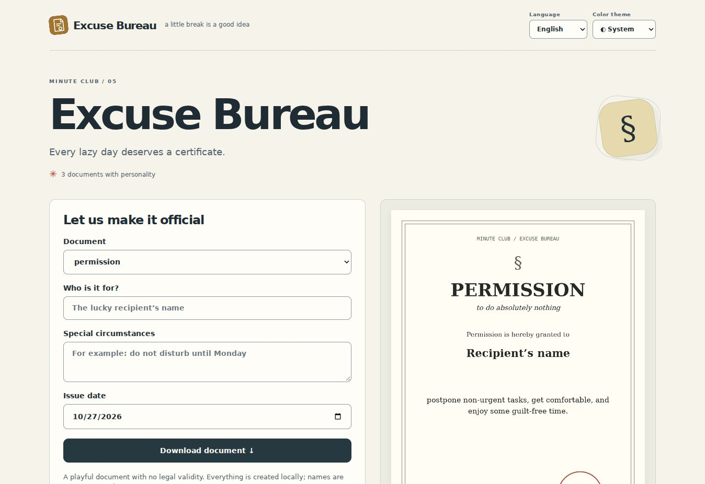

<div align="center">


# Excuse Bureau

**Make it unofficial.**

Turn a small excuse into a playful certificate worth sharing.

**English** · [Русский](README.ru.md)

  

</div>

[Features](#features) · [Stack](#technology-stack) · [Quick start](#quick-start) · [License](LICENSE)



*Actual browser capture. Documents are playful examples, not official certificates.*

## Features

- Three playful document templates
- Customize the name, note, and date
- Live preview, local drafts, and PNG export

**Try the flow: Choose a template → personalize → download.**

Documentation: English / Русский. App interface: English, Русский, selected from browser preferences or manually. System theme by default, with explicit light and dark modes. The system mode follows device changes; your choice is saved locally.

## Technology stack

| Layer | Implementation |
| --- | --- |
| Interface | HTML · CSS · JavaScript / native ES modules |
| Runtime | Browser only |
| Development | JavaScript |
| Dependencies | No third-party browser libraries or remote fonts |

## Quick start

Serve `public/` with any static HTTP server at a domain root. For a local preview, for example:

```sh
python3 -m http.server 8080 --directory public
```

Open http://localhost:8080. Opening the HTML via `file://` is unsupported because native ES modules need HTTP. No Node.js server, database, API key, or build is needed in production.

## Checks

With Node.js 24+: `npm test` and `npm run check`.

## Deployment and data

Upload the contents of `public/` to your static host. Absolute asset paths assume a domain root; a GitHub Pages project subpath requires adapting paths or using a custom domain. Certificate names and preferences stay on the device. Clearing site data removes drafts. Exported PNG files are created locally.

Three playful document templates, live preview, name/note/date customization, local drafts, and PNG export. These documents have no legal validity.

---

[More by den9911](https://github.com/den9911) · [Report an issue](https://github.com/den9911/excuse-bureau/issues) · [LICENSE](LICENSE)
